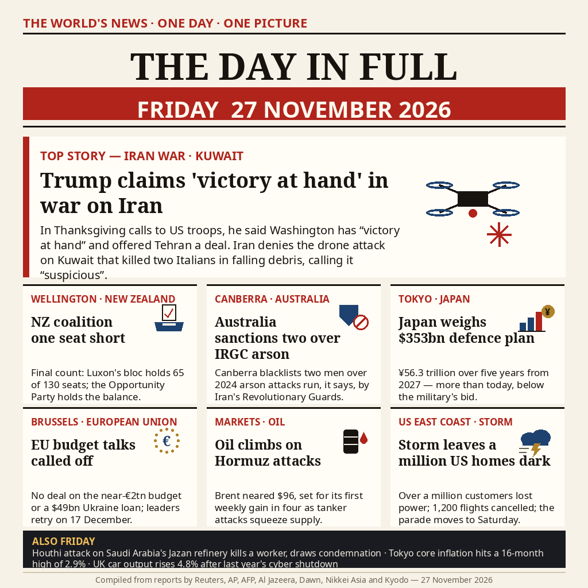

# The Day in Full — Friday 27 November 2026

A hand-drawn newspaper front page that sums up one day of world news
in a single 1024×1024 picture: Friday 27 November 2026.

## What's on the page

- **Lead** — Trump claims "victory at hand" in the war on Iran and
  offers Tehran a deal; Iran denies the drone attack on Kuwait in
  which two Italians died in falling debris.
- **Wellington** — New Zealand's final election count leaves Prime
  Minister Luxon's coalition one seat short of a majority.
- **Canberra** — Australia sanctions two men over IRGC-linked arson
  attacks in Sydney and Melbourne.
- **Tokyo** — Japan weighs ¥56.3 trillion (≈$353bn) of defence
  spending over five years from 2027.
- **Brussels** — EU leaders call off budget talks without a deal on
  the near-€2tn budget or a $49bn Ukraine loan.
- **Markets** — Brent nears $96 as Hormuz tanker attacks menace
  supply, heading for its first weekly gain in four.
- **US East Coast** — the Thanksgiving storm leaves over a million
  customers without power and cancels 1,200 flights.
- **Ticker** — the Jazan refinery attack, Tokyo's 16-month-high
  inflation, and UK car output's post-cyber-attack recovery.

Every story was reported on 27 November 2026 and cross-checked in at
least two independent outlets before it was drawn. `SOURCES.md` lists
the sources per story — and the items that were checked, found to
belong to an earlier day, and deliberately left out.

## How it runs

The grader runs `main.ts` offline in Node; it copies the committed
`entry.png` into `$MAKEFUN_OUTPUT_DIR` (or `/output`). The picture
itself is drawn by `tools/render.py` (Python + Pillow, system fonts
only): fixed canvas, no randomness, no clock, no network — two runs
produce byte-identical output.

## License

MIT — see `LICENSE`.
